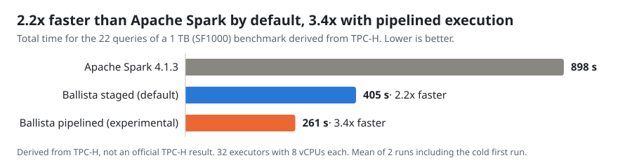
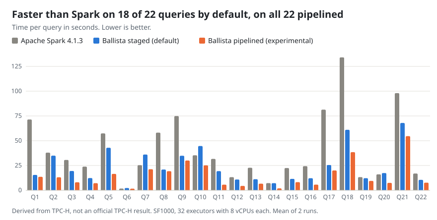
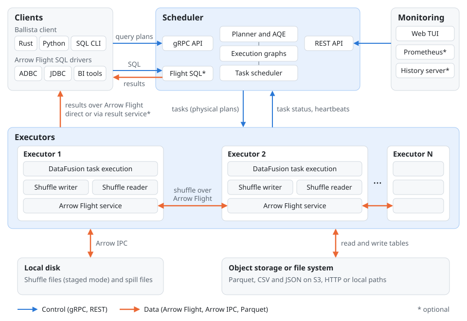
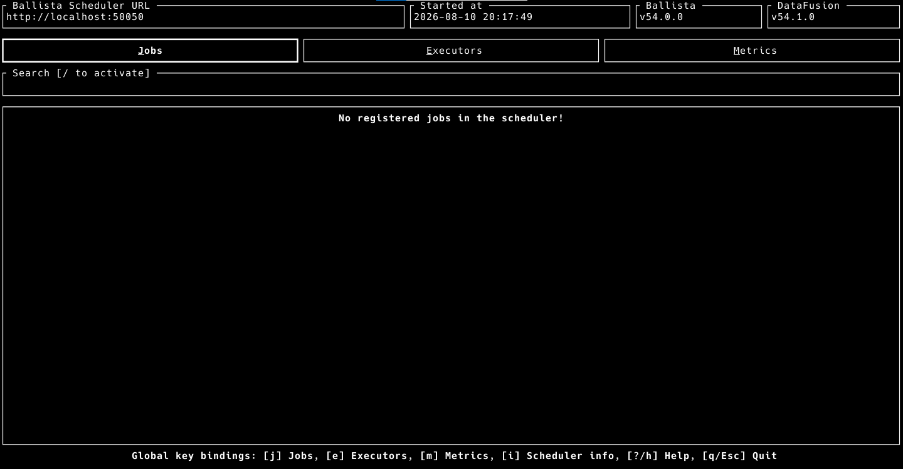
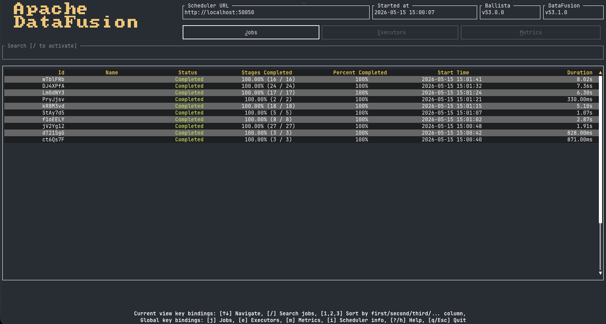

<!---
  Licensed to the Apache Software Foundation (ASF) under one
  or more contributor license agreements.  See the NOTICE file
  distributed with this work for additional information
  regarding copyright ownership.  The ASF licenses this file
  to you under the Apache License, Version 2.0 (the
  "License"); you may not use this file except in compliance
  with the License.  You may obtain a copy of the License at

    http://www.apache.org/licenses/LICENSE-2.0

  Unless required by applicable law or agreed to in writing,
  software distributed under the License is distributed on an
  "AS IS" BASIS, WITHOUT WARRANTIES OR CONDITIONS OF ANY
  KIND, either express or implied.  See the License for the
  specific language governing permissions and limitations
  under the License.
-->

# Ballista: Making DataFusion Applications Distributed

[![Crates.io][crates-badge]][crates-url]
[![PyPI][pypi-badge]][pypi-url]
[![Apache licensed][license-badge]][license-url]
[![Commit activity][activity-badge]][activity-url]

[crates-badge]: https://img.shields.io/crates/v/ballista.svg
[crates-url]: https://crates.io/crates/ballista
[pypi-badge]: https://img.shields.io/pypi/v/ballista.svg
[pypi-url]: https://pypi.org/project/ballista/
[license-badge]: https://img.shields.io/badge/license-Apache%20v2-blue.svg
[license-url]: https://github.com/apache/datafusion-ballista/blob/main/LICENSE.txt
[activity-badge]: https://img.shields.io/github/commit-activity/m/apache/datafusion-ballista
[activity-url]: https://github.com/apache/datafusion-ballista/commits/main

<picture>
  <source media="(prefers-color-scheme: dark)" srcset="docs/source/_static/images/ballista_white.png">
  
</picture>

Ballista is a distributed query execution engine that enhances [Apache DataFusion](https://github.com/apache/datafusion)
by enabling the parallelized execution of workloads across multiple nodes in a distributed environment.

It is also a lighter, Rust-native alternative to [Apache Spark](https://spark.apache.org), keeping the same execution
model of stages, shuffles and adaptive query execution. On a 1 TB benchmark derived from TPC-H, Ballista is
**2.2x faster than Spark** by default and **3.4x faster** with experimental pipelined execution.

An existing DataFusion application can be distributed with a few lines of code changed:

```diff
+use ballista::prelude::*;
 use datafusion::prelude::*;

 #[tokio::main]
 async fn main() -> datafusion::error::Result<()> {
-    let ctx = SessionContext::new();
+    // create SessionContext with ballista support
+    // standalone context will start all required
+    // ballista infrastructure in the background as well
+    let ctx = SessionContext::standalone().await?;

     // register the table
     ctx.register_csv("example", "tests/data/example.csv", CsvReadOptions::new())
         .await?;

     // create a plan to run a SQL query
     let df = ctx
         .sql("SELECT a, MIN(b) FROM example WHERE a <= b GROUP BY a LIMIT 100")
         .await?;

     // execute and print results
     df.show().await?;
     Ok(())
 }
```

For documentation or more examples, please refer to the [Ballista User Guide][user-guide].

## Performance

Ballista is measured against Apache Spark 4.1.3 on the same cluster shape: Kubernetes on AWS, with 32 executors of
8 vCPUs running the 22 queries over 1 TB of Parquet in S3. Each Ballista executor had 64 GiB of memory, and each Spark
executor 74 GiB.





Derived from TPC-H and not an official TPC-H result. Times are the mean of two runs, including the cold first run. The
Spark numbers come from an earlier run with separate scripts and its own phrasing of the queries. See the
[benchmarking guide](docs/source/contributors-guide/benchmarking/index.md) for versions, settings, the full results and
how to reproduce them.

## Features

### Query interfaces

- **SQL and DataFrames** from Rust and Python, using DataFusion's APIs
- **Arrow Flight SQL**, so ADBC and JDBC drivers and BI tools can query a cluster without linking Ballista
- **SQL CLI** with a built-in terminal UI
- **Substrait and physical plans** accepted alongside logical plans
- **`DataFrame.cache()`** keeps intermediate results on the executors for reuse within a session (opt-in)

### Execution

- **Adaptive query execution**, on by default, re-optimizes the remaining plan from runtime statistics: join selection,
  broadcast joins, empty-stage elimination and exchange reuse, with opt-in skew-join splitting and partition coalescing
- **Two execution modes**: fault-tolerant staged execution by default, and low-latency pipelined execution (experimental)
- **Memory-bounded executors** with an auto-sized pool by default, and spilling to disk
- **Sort-based and hash shuffle** with configurable compression
- **Multi-partition tasks** that share memory and broadcast state across a stage's partitions
- **Parallel window functions** over range shuffles (opt-in)

### Operations

- **Deployment** as native binaries or Docker images, with Docker Compose and Kubernetes guides and optional KEDA
  autoscaling
- **Fault tolerance**: failed tasks are retried, and work lost with an executor is re-run
- **Graceful shutdown** and Kubernetes health probes
- **Observability**: a browser-based Web TUI, a terminal UI, a REST API with an OpenAPI spec, Prometheus metrics, and a
  history server for completed jobs
- **Result service** for clients outside the cluster network
- **Data access** to Parquet, CSV and JSON on S3-compatible object stores, HTTP and local filesystems

### Extensibility

- **Reusable components**: embed the scheduler and executor crates in your own engine
- **Extension points** for custom operators and codecs, functions, object stores, session configuration and adaptive
  optimizer rules

## Who is Ballista for

Ballista serves several distinct audiences:

- **DataFusion users going multi-node** — you already use [Apache DataFusion](https://github.com/apache/datafusion) on a single machine and have outgrown it. Ballista runs the same SQL and DataFrame workloads across a cluster with minimal code changes and the same results.
- **Spark users wanting the same execution model** — you run Spark SQL or batch jobs and want a lighter, Rust-native alternative without relearning a new paradigm. Ballista keeps the familiar model: plans split into stages at shuffle boundaries, tasks over partitions, executors with vcores, and adaptive query execution (AQE).
- **Library users building a specialized engine** — you are building a bespoke distributed query engine and want reusable scheduler, executor, and plan-serialization building blocks with extension points, instead of writing distributed execution from scratch.

These audiences are documented in more detail, along with the guarantees each relies on, in the [User Personas](docs/source/contributors-guide/user-personas.md) guide.

## Architecture

A Ballista cluster consists of one or more scheduler processes and one or more executor processes. These processes
can be run as native binaries and are also available as Docker Images, which can be easily deployed with
[Docker Compose](https://datafusion.apache.org/ballista/user-guide/deployment/docker-compose.html) or
[Kubernetes](https://datafusion.apache.org/ballista/user-guide/deployment/kubernetes.html).

Clients submit query plans to the scheduler over gRPC, or SQL over Arrow Flight SQL. The scheduler breaks each query
into stages and sends tasks to the executors, which report progress back. Executors exchange shuffle data with each
other over Arrow Flight and return results to the client the same way.



See the [architecture guide](docs/source/contributors-guide/architecture.md) for more details.

## Execution Modes

Ballista supports two execution modes, selected with `ballista.execution.mode`. Staged execution, the default, runs a job one stage at a time, the way [Apache Spark](https://spark.apache.org) does: each stage writes its output to shuffle files, and a failed task is simply re-run from them, which suits long-running jobs and busy shared clusters.

Pipelined execution (experimental) runs a job the way [Trino](https://trino.io) does: every task is scheduled at once and stages stream record batches to each other over Arrow Flight, with no intermediate data written to disk, so results reach the client sooner, at the cost of a failed task failing the whole job. It suits short, latency-sensitive queries on clusters with room for the whole job. See the [Pipelined Execution Guide](docs/source/user-guide/pipelined-execution.md) for details.

## Getting Started

The easiest way to get started is to run one of the standalone or distributed [examples](./examples/README.md). After
that, refer to the [Getting Started Guide](ballista/client/README.md).

## Web Terminal User Interface (Web TUI)

Ballista provides a browser-based Web TUI for monitoring a running cluster. It exposes the TUI views for jobs, executors, metrics, and scheduler information directly in a web browser.



When the scheduler HTTP endpoint is available, opening the scheduler address in a browser, for example `http://localhost:50050`, redirects to a hosted Web TUI.

For more information, including how to run the Web TUI locally, see the [Ballista CLI documentation](https://datafusion.apache.org/ballista/user-guide/cli.html).

## Project Status

Ballista is part of the [Apache DataFusion](https://datafusion.apache.org) project at the Apache Software Foundation.
It ships about every two months alongside DataFusion. [Adopters](docs/source/community/adopters.md) include Spice AI and
Coralogix.

Changes are tested on real clusters before they merge:

- The merge queue runs TPC-H (SF10) and TPC-DS (SF1) queries on a multi-process cluster and compares the results with
  single-process DataFusion, including runs with multi-partition tasks and, for TPC-H, pipelined mode.
- A fault-injection suite kills executors mid-query, with AQE on and off, and checks that the results are still
  correct. It runs on every code change, and its Kubernetes scenarios also run nightly.
- Upgrade guides cover breaking changes between releases, and clients get a clear error when their major version
  doesn't match the scheduler's.

Ballista supports a wide range of SQL, including CTEs, joins and subqueries, and can execute complex queries at scale,
but there is still a gap between DataFusion and Ballista, which may bring incompatibilities. The community is actively
working to close it. Refer to the [DataFusion SQL Reference](https://datafusion.apache.org/user-guide/sql/index.html)
for more information on supported SQL.

## Cargo Features

Ballista uses Cargo features to enable optional functionality.

<details>
<summary>Cargo features for each crate</summary>

### ballista (client)

| Feature      | Default | Description                                                    |
| ------------ | ------- | -------------------------------------------------------------- |
| `standalone` | Yes     | Enables standalone mode with in-process scheduler and executor |

### ballista-core

| Feature                   | Default | Description                                                                                    |
| ------------------------- | ------- | ---------------------------------------------------------------------------------------------- |
| `arrow-ipc-optimizations` | Yes     | Enables Arrow IPC optimizations for better shuffle performance                                 |
| `build-binary`            | No      | Required for building binary executables (AWS S3 support, CLI parsing)                         |
| `force_hash_collisions`   | No      | Testing-only: forces all values to hash to same value                                          |
| `utoipa`                  | No      | Derives OpenAPI schemas for scheduler REST types; enabled by `ballista-scheduler`'s `rest-api` |

### ballista-scheduler

| Feature                    | Default | Description                                                          |
| -------------------------- | ------- | -------------------------------------------------------------------- |
| `build-binary`             | Yes     | Builds the scheduler binary with CLI and logging                     |
| `substrait`                | No      | Enables Substrait plan support                                       |
| `flight-sql`               | No      | Enables the Arrow Flight SQL frontend for ADBC and JDBC clients      |
| `prometheus-metrics`       | No      | Enables Prometheus metrics collection                                |
| `graphviz-support`         | No      | Enables execution graph visualization                                |
| `keda-scaler`              | No      | Kubernetes Event Driven Autoscaling integration                      |
| `rest-api`                 | Yes     | Enables REST API endpoints, the OpenAPI spec, and the history server |
| `disable-stage-plan-cache` | No      | Disables caching of stage execution plans                            |

### ballista-executor

| Feature                   | Default | Description                                           |
| ------------------------- | ------- | ----------------------------------------------------- |
| `arrow-ipc-optimizations` | Yes     | Enables Arrow IPC optimizations                       |
| `build-binary`            | Yes     | Builds the executor binary with CLI and logging       |
| `mimalloc`                | Yes     | Uses mimalloc memory allocator for better performance |

### ballista-cli

| Feature | Default | Description                                                         |
| ------- | ------- | ------------------------------------------------------------------- |
| `cli`   | Yes     | Builds the `ballista-cli` SQL shell binary                          |
| `tui`   | Yes     | Enables a REST client with Terminal User Interface                  |
| `web`   | No      | Builds the WebAssembly Web TUI (see the Ballista CLI documentation) |



### Usage Examples

```bash
# Build with standalone support (default)
cargo build -p ballista

# Build with Substrait support
cargo build -p ballista-scheduler --features substrait
```

</details>

## Contribution Guide

Please see the [Contribution Guide](CONTRIBUTING.md) for information about contributing to Ballista.

[user-guide]: https://datafusion.apache.org/ballista/
