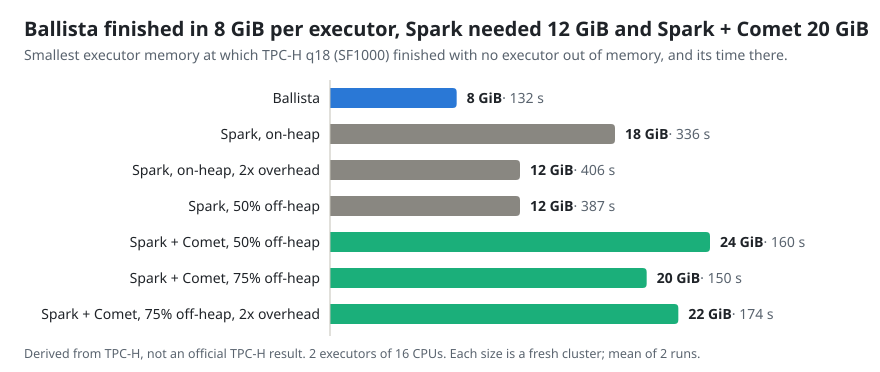
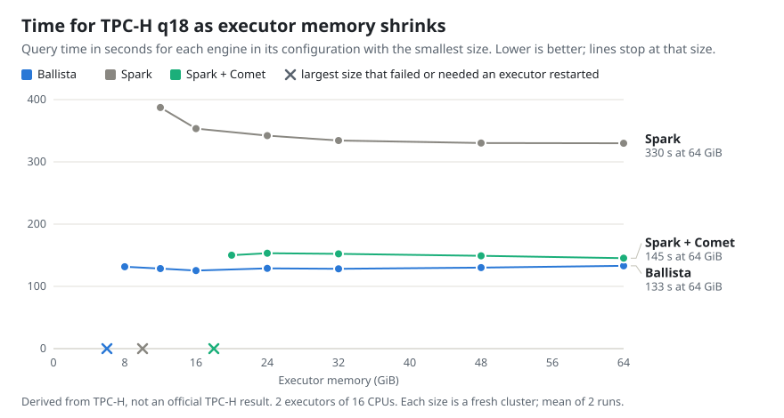

<!---
  Licensed to the Apache Software Foundation (ASF) under one
  or more contributor license agreements.  See the NOTICE file
  distributed with this work for additional information
  regarding copyright ownership.  The ASF licenses this file
  to you under the Apache License, Version 2.0 (the
  "License"); you may not use this file except in compliance
  with the License.  You may obtain a copy of the License at

    http://www.apache.org/licenses/LICENSE-2.0

  Unless required by applicable law or agreed to in writing,
  software distributed under the License is distributed on an
  "AS IS" BASIS, WITHOUT WARRANTIES OR CONDITIONS OF ANY
  KIND, either express or implied.  See the License for the
  specific language governing permissions and limitations
  under the License.
-->

# Memory Usage

How much executor memory Ballista, Spark and Spark + Comet need to run one
memory-intensive query, and how their speed changes as that memory shrinks.
Executor memory is what a cluster is sized for: each executor reserves it for
the whole job, so an engine that finishes in less memory runs on smaller or
fewer machines.

These runs were made on a different, much smaller cluster than the
[TPC-H results](index.md), so their times are not comparable with that table.

## How it was measured

- **Query:** TPC-H q18 at SF1000. Its subquery aggregates all of `lineitem` by
  order key, about 1.5 billion groups, and the result is joined with
  `orders`, `customer` and `lineitem`. It has the largest aggregation in TPC-H
  and large join inputs.
- **Cluster:** Kubernetes on two servers with 32 CPU cores and 125 GiB of
  memory each, and 2 executors of 16 CPUs, one per server. The Parquet files
  were on each server's local disk, not in S3.
- **Memory:** the executor pod's Kubernetes memory limit, which is everything
  the executor process may use. Each configuration was run at 64, 48, 32, 24,
  16, 12 and 8 GiB until a size failed, and then at sizes in between, to
  within 2 GiB (1 GiB for Ballista below 8 GiB) of the smallest size that
  passed.
- **Passed** means the query finished with no executor killed for running out
  of memory. Every size is a fresh cluster, and the query ran twice; times are
  the mean.
- **Versions:** Ballista
  [`d9872080`](https://github.com/apache/datafusion-ballista/commit/d98720804369917151052e1c280a1dae711817fb)
  with its default settings, Spark `4.1.3` with the settings in
  [`conf/spark.conf`](https://github.com/apache/datafusion-ballista/blob/main/benchmarks/cluster/conf/spark.conf),
  and Comet `1.2.0` on the same Spark with
  [`conf/comet.conf`](https://github.com/apache/datafusion-ballista/blob/main/benchmarks/cluster/conf/comet.conf).

How an executor divides its memory is a setting, and for Spark it changes the
result. A Spark executor's memory is its Java heap, optional off-heap memory
and `spark.executor.memoryOverhead` for everything else the process allocates.
Comet runs its native engine in the off-heap memory. Spark and Comet were each
run with several divisions, given in the tables as shares of the executor's
memory. A Ballista executor gives 70% of its memory to the DataFusion memory
pool that operators allocate from, and was run only with that default.

## Results





<!-- BEGIN GENERATED MEMORY SUMMARY -->

| Configuration                            | Memory split                             | Smallest size (GiB) | Mean there (s) | Largest size (GiB) | Mean there (s) |
| ---------------------------------------- | ---------------------------------------- | ------------------: | -------------: | -----------------: | -------------: |
| Ballista                                 | memory pool 70% (default)                |                   8 |         131.54 |                 64 |         133.01 |
| Spark, on-heap                           | heap 90%, overhead 10%                   |                  18 |         336.23 |                 64 |         337.11 |
| Spark, on-heap, 2x overhead              | heap 80%, overhead 20%                   |                  12 |         406.50 |                 24 |         331.87 |
| Spark, 50% off-heap                      | heap 45%, off-heap 45%, overhead 10%     |                  12 |         387.32 |                 64 |         329.89 |
| Spark + Comet, 50% off-heap              | heap 45%, off-heap 45%, overhead 10%     |                  24 |         159.75 |                 64 |         148.50 |
| Spark + Comet, 75% off-heap              | heap 22.5%, off-heap 67.5%, overhead 10% |                  20 |         150.10 |                 64 |         145.30 |
| Spark + Comet, 75% off-heap, 2x overhead | heap 20%, off-heap 60%, overhead 20%     |                  22 |         174.38 |                 24 |         158.65 |

<!-- END GENERATED MEMORY SUMMARY -->

- **Ballista** finished in the least memory, and its time stayed within a few
  seconds from 64 GiB down to its smallest size. The memory its executors held
  fell with the limit, so it ran the query in whatever memory it was given.
- **Spark's smallest size was set by `memoryOverhead`, not the heap.** At
  16 GiB with all its memory on-heap, Spark's executors went over their pod
  limit without the Java heap running out, and lost shuffle output then failed
  the query. Moving half of the heap off-heap, or doubling the overhead, let it
  finish in 12 GiB. Below about 24 GiB it slowed down.
- **Comet made Spark about twice as fast, but needed more memory than Spark.**
  Every Comet failure was an executor killed for going over its pod limit,
  never an error from Comet's memory pool, so Comet allocates memory that its
  pool does not account for. A larger off-heap share lowered its smallest size;
  a larger overhead did not.
- **Below its smallest size, Ballista did not fail cleanly.** At 6 GiB
  executors were killed for running out of memory and restarted, and the query
  finished at about a third of its usual speed. At 5 and 4 GiB the query
  stopped making progress after the restarts instead of failing, and was
  stopped at the time limit.

Each size ran once, so a size close to an engine's smallest could go either way
on another run.

## Reproducing

Every point is one run of
[`benchmarks/cluster/run.py`](https://github.com/apache/datafusion-ballista/tree/main/benchmarks/cluster)
with the size and division of memory given as flags. For example, Ballista and
Spark with half its memory off-heap at 12 GiB:

```sh
cd benchmarks/cluster
COMMON="--query 18 --executors 2 --executor-cpus 16 --driver-cpus 4 --driver-memory-gib 16"
python3 run.py --engine ballista $COMMON --vcores 16 --executor-memory-gib 12
python3 run.py --engine spark $COMMON \
  --spark-conf spark.executor.cores=16 \
  --spark-conf spark.executor.memory=5529m \
  --spark-conf spark.memory.offHeap.enabled=true \
  --spark-conf spark.memory.offHeap.size=5530m \
  --spark-conf spark.executor.memoryOverhead=1229m
```

`run.py` reads the data from S3, which these runs did not, so expect different
times. The results are in
[`published/memory`](https://github.com/apache/datafusion-ballista/tree/main/benchmarks/cluster/published/memory),
and `publish.py` generates the tables and charts on this page from them.

## All runs

<!-- BEGIN GENERATED MEMORY RUNS -->

| Configuration                            | Executor (GiB) | Heap / off-heap / overhead (GiB) | Result                                     | Mean (s) | Iterations (s) |
| ---------------------------------------- | -------------: | -------------------------------: | ------------------------------------------ | -------: | -------------: |
| Ballista                                 |             64 |                 memory pool 44.8 | Passed                                     |   133.01 | 136.90, 129.11 |
|                                          |             48 |                 memory pool 33.6 | Passed                                     |   130.14 | 129.49, 130.80 |
|                                          |             32 |                 memory pool 22.4 | Passed                                     |   128.22 | 127.80, 128.65 |
|                                          |             24 |                 memory pool 16.8 | Passed                                     |   128.95 | 127.57, 130.34 |
|                                          |             16 |                 memory pool 11.2 | Passed                                     |   125.40 | 124.89, 125.91 |
|                                          |             12 |                  memory pool 8.4 | Passed                                     |   128.60 | 129.69, 127.53 |
|                                          |              8 |                  memory pool 5.6 | Passed                                     |   131.54 | 132.18, 130.90 |
|                                          |              6 |                  memory pool 4.2 | Passed after 2 executors ran out of memory |   363.11 | 366.22, 360.00 |
|                                          |              5 |                  memory pool 3.5 | Did not finish within the time limit       |          |                |
|                                          |              4 |                  memory pool 2.8 | Did not finish within the time limit       |          |                |
| Spark, on-heap                           |             64 |                 57.6 / 0.0 / 6.4 | Passed                                     |   337.11 | 328.35, 345.87 |
|                                          |             48 |                 43.2 / 0.0 / 4.8 | Passed                                     |   341.81 | 339.37, 344.24 |
|                                          |             32 |                 28.8 / 0.0 / 3.2 | Passed                                     |   331.16 | 328.01, 334.32 |
|                                          |             24 |                 21.6 / 0.0 / 2.4 | Passed                                     |   329.85 | 322.26, 337.43 |
|                                          |             20 |                 18.0 / 0.0 / 2.0 | Passed                                     |   334.06 | 326.78, 341.33 |
|                                          |             18 |                 16.2 / 0.0 / 1.8 | Passed                                     |   336.23 | 330.08, 342.37 |
|                                          |             16 |                 14.4 / 0.0 / 1.6 | Failed: an executor ran out of memory      |          |                |
| Spark, on-heap, 2x overhead              |             24 |                 19.2 / 0.0 / 4.8 | Passed                                     |   331.87 | 321.57, 342.17 |
|                                          |             20 |                 16.0 / 0.0 / 4.0 | Passed                                     |   339.06 | 333.09, 345.03 |
|                                          |             16 |                 12.8 / 0.0 / 3.2 | Passed                                     |   343.40 | 346.15, 340.65 |
|                                          |             12 |                  9.6 / 0.0 / 2.4 | Passed                                     |   406.50 | 393.29, 419.70 |
|                                          |              8 |                  6.4 / 0.0 / 1.6 | Passed after 4 executors ran out of memory |   693.86 | 723.26, 664.45 |
| Spark, 50% off-heap                      |             64 |                28.8 / 28.8 / 6.4 | Passed                                     |   329.89 | 331.98, 327.80 |
|                                          |             48 |                21.6 / 21.6 / 4.8 | Passed                                     |   330.26 | 330.95, 329.58 |
|                                          |             32 |                14.4 / 14.4 / 3.2 | Passed                                     |   334.27 | 335.93, 332.61 |
|                                          |             24 |                10.8 / 10.8 / 2.4 | Passed                                     |   342.15 | 340.42, 343.89 |
|                                          |             16 |                  7.2 / 7.2 / 1.6 | Passed                                     |   353.43 | 359.04, 347.83 |
|                                          |             12 |                  5.4 / 5.4 / 1.2 | Passed                                     |   387.32 | 391.03, 383.61 |
|                                          |             10 |                  4.5 / 4.5 / 1.0 | Passed after 2 executors ran out of memory |   501.25 | 600.58, 401.91 |
|                                          |              8 |                  3.5 / 3.5 / 1.0 | Failed: an executor ran out of memory      |          |                |
| Spark + Comet, 50% off-heap              |             64 |                28.8 / 28.8 / 6.4 | Passed                                     |   148.50 | 150.76, 146.24 |
|                                          |             48 |                21.6 / 21.6 / 4.8 | Passed                                     |   153.68 | 155.36, 151.99 |
|                                          |             32 |                14.4 / 14.4 / 3.2 | Passed                                     |   158.00 | 160.04, 155.95 |
|                                          |             24 |                10.8 / 10.8 / 2.4 | Passed                                     |   159.75 | 163.86, 155.64 |
|                                          |             22 |                  9.9 / 9.9 / 2.2 | Failed: an executor ran out of memory      |          |                |
|                                          |             20 |                  9.0 / 9.0 / 2.0 | Failed: an executor ran out of memory      |          |                |
|                                          |             16 |                  7.2 / 7.2 / 1.6 | Failed: an executor ran out of memory      |          |                |
| Spark + Comet, 75% off-heap              |             64 |                14.4 / 43.2 / 6.4 | Passed                                     |   145.30 | 145.74, 144.86 |
|                                          |             48 |                10.8 / 32.4 / 4.8 | Passed                                     |   149.09 | 150.66, 147.51 |
|                                          |             32 |                 7.2 / 21.6 / 3.2 | Passed                                     |   152.25 | 153.69, 150.81 |
|                                          |             24 |                 5.4 / 16.2 / 2.4 | Passed                                     |   153.26 | 156.09, 150.44 |
|                                          |             20 |                 4.5 / 13.5 / 2.0 | Passed                                     |   150.10 | 148.50, 151.69 |
|                                          |             18 |                 4.0 / 12.2 / 1.8 | Failed: an executor ran out of memory      |          |                |
|                                          |             16 |                 3.6 / 10.8 / 1.6 | Failed: an executor ran out of memory      |          |                |
| Spark + Comet, 75% off-heap, 2x overhead |             24 |                 4.8 / 14.4 / 4.8 | Passed                                     |   158.65 | 157.95, 159.35 |
|                                          |             22 |                 4.4 / 13.2 / 4.4 | Passed                                     |   174.38 | 155.53, 193.22 |
|                                          |             20 |                 4.0 / 12.0 / 4.0 | Failed: an executor ran out of memory      |          |                |

<!-- END GENERATED MEMORY RUNS -->
